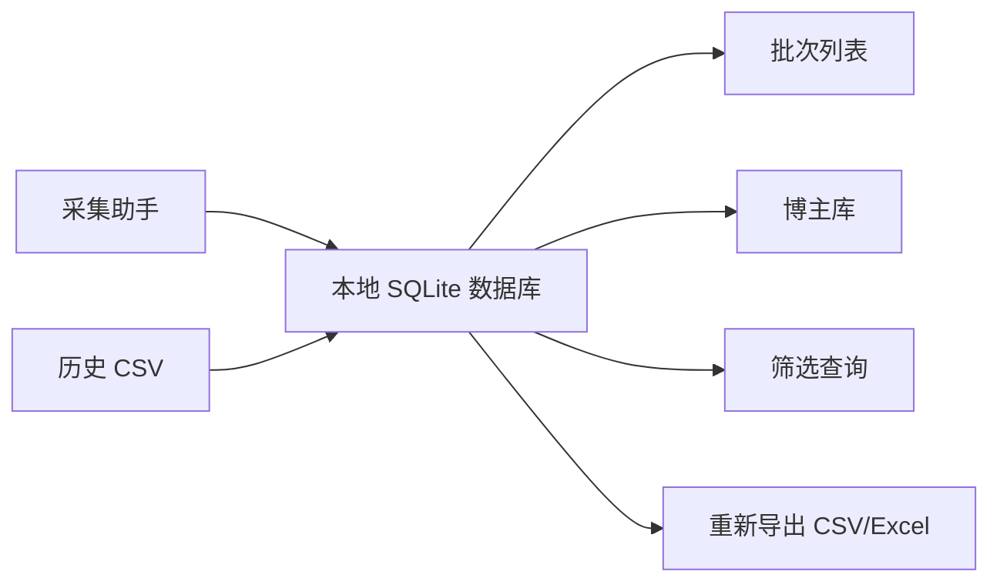

# 采集数据入库架构设计

日期：2026-05-25

## 1. 一句话目标

把采集助手导出的博主数据，从一次性 CSV 文件，升级为可查询、可复盘、可持续更新的用户数据库。

## 2. 当前现状

当前采集链路是：

这个方式适合早期验证，但问题是：

- 每次采集都是孤立文件
- 同一个博主多次采集无法自动合并
- 不方便看历史变化
- 不方便按客户、批次、标签、报价、粉丝量长期筛选
- 不方便后续做推荐、评分、复盘和 CRM

## 3. 推荐架构

第一阶段建议先做“本地数据库 + 可导入导出”，不要一上来做复杂服务端。

原因：

- Mac 单机工具落地最快
- 不需要客户额外配置服务器
- 数据在用户本机，交付阻力低
- 后续可以再同步到云端

## 4. 核心数据表

### 4.1 customers 客户表

用于记录授权客户或使用方。

建议字段：

- `id`：内部 ID
- `customer_name`：客户名
- `license_code`：授权码
- `machine_id`：机器码
- `created_at`：创建时间
- `updated_at`：更新时间

### 4.2 collect_batches 采集批次表

每次点击开始采集，生成一个批次。

建议字段：

- `id`：批次 ID
- `customer_id`：客户 ID
- `task_mode`：当前列表 / 博主昵称上传 / 相似博主
- `collect_mode`：常规采集 / 增强采集
- `source_name`：筛选条件说明、上传文件名或种子昵称
- `max_pages`：最大页数
- `per_page_limit`：每页最多
- `started_at`：开始时间
- `finished_at`：完成时间
- `status`：完成 / 中止 / 失败
- `total_collected`：采集数量
- `empty_recheck_count`：补采数量

### 4.3 bloggers 博主主表

一位博主只保留一条主记录。

建议字段：

- `id`：内部 ID
- `blogger_id`：蒲公英博主 ID
- `blogger_url`：小红书主页链接
- `nickname`：昵称
- `red_id`：小红书号
- `province`：省
- `city`：市
- `mcn_name`：机构名
- `mcn_status`：机构状态
- `created_at`：首次入库时间
- `updated_at`：最近更新时间

去重规则：

- 优先按 `blogger_id` 去重
- 没有 `blogger_id` 时，按 `nickname + red_id` 辅助判断

### 4.4 blogger_snapshots 博主快照表

每次采集到同一个博主，都写一条快照，保留历史变化。

建议字段：

- `id`：快照 ID
- `batch_id`：批次 ID
- `blogger_id`：博主主表 ID
- `fans_count`：粉丝数
- `read_median_30d`：阅读中位数，近 30 日
- `interaction_median_30d`：互动中位数，近 30 日
- `image_note_price`：图文报价
- `video_note_price`：视频报价
- `exposure_median_30d`：曝光中位数，近 30 日
- `like_median_30d`：点赞中位数，近 30 日
- `collect_median_30d`：收藏中位数，近 30 日
- `comment_median_30d`：评论中位数，近 30 日
- `cooperation_notes_30d`：合作笔记数，近 30 日
- `cooperation_notes_90d`：合作笔记数，近 90 日
- `cooperation_notes_total`：累计商业笔记数
- `raw_json`：本次采集原始结构化数据
- `collected_at`：采集时间

### 4.5 blogger_tags 博主标签表

用于保存标签、内容分类、兴趣等多值字段。

建议字段：

- `id`
- `blogger_id`
- `tag_type`：列表标签 / 内容标签 / 粉丝兴趣 / 相似博主标签
- `tag_name`
- `source`：列表页 / 详情页

### 4.6 batch_items 批次明细表

用于记录某个博主在某次批次里的位置和采集状态。

建议字段：

- `id`
- `batch_id`
- `blogger_id`
- `seed_nickname`：如果是昵称上传或相似博主，记录种子昵称
- `page_no`
- `rank_in_page`
- `status`：成功 / 空值补采后成功 / 部分缺失 / 失败
- `missing_fields`：仍为空的字段列表
- `error_message`：错误信息

## 5. 第一阶段功能范围

建议第一阶段只做这些：

1. 采集完成后自动写入本地 SQLite
2. 支持导入历史 CSV
3. 支持按批次查看采集结果
4. 支持按昵称、粉丝数、报价、地区、标签搜索博主
5. 支持从数据库重新导出 CSV

暂时不做：

- 多人协作
- 云端账号体系
- 在线支付
- 实时同步
- 复杂 BI 看板

## 6. 第二阶段功能范围

第二阶段再做：

- 博主历史变化对比
- 同一博主多次采集的趋势
- 客户备注、收藏、黑名单
- 博主评分
- 按预算/地区/标签推荐
- 云端同步

## 7. 当前建议结论

先在采集助手里内置 SQLite，是最稳的下一步。

它不改变用户当前使用习惯：用户仍然登录蒲公英、点击开始采集、导出表格。只是工具内部多一步“自动存入本地数据库”，以后才有条件做长期复用和分析。
