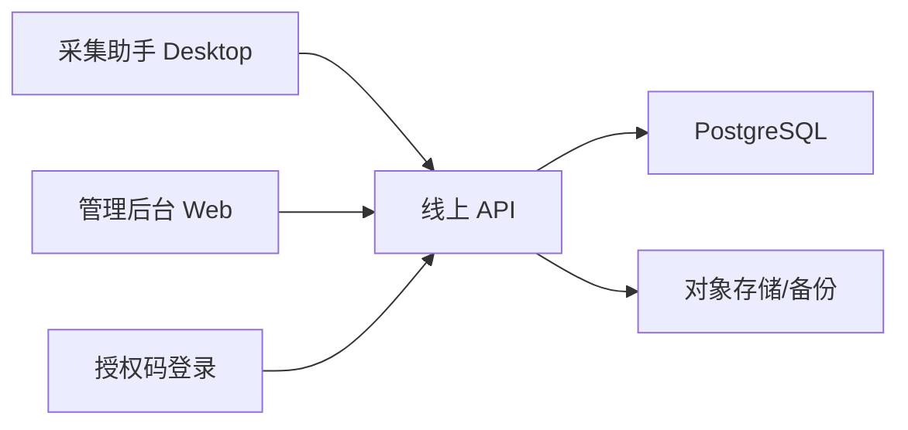

# 服务器版数据库后台规划

日期：2026-06-03

> 2026-09-13更新：本文件保留历史讨论。当前推荐以[云端数据库迁移建议](2026-09-13-cloud-database-migration-plan.md)为准，直接采用PostgreSQL并先修复账号鉴权/同步可靠性；下面的SQLite过渡路线、容量估计和服务器连通性仅代表6月状态，不能直接当作当前上线依据。

## 1. 一句话目标

把当前本地 `data-console` 升级为可部署到服务器的独立后台，承接授权码管理、采集数据入库、员工查询筛选、备注协作和后续多设备访问。

## 2. 当前边界

本阶段只做代码和规划，不直接部署。

明确不做：

- 不改 youbet 业务代码
- 不覆盖 `/opt/bc`
- 不改 smarterbet 现有业务数据库
- 不把采集助手服务混进 youbet 进程

如果后续部署到 youbet 所在服务器，建议作为独立服务运行，例如：

- 服务目录：`/opt/pgy-data-console`
- 数据目录：`/opt/pgy-data-console-data`
- 内部端口：`127.0.0.1:3188`
- 对外入口：独立子域名或 nginx 路径，例如 `/pgy/`

## 3. 推荐线上架构



第一阶段可以继续用 SQLite 上服务器验证流程；正式多人使用建议迁移 PostgreSQL。

原因：

- SQLite 适合本机和小流量演示
- PostgreSQL 更适合多人同时查询、写备注、做备份和后续权限控制
- 授权码和采集数据都在服务端后，客户本地不再保存长期主库

## 4. 授权中心

### 4.1 当前已落地能力

`data-console 0.2.0` 已新增：

- `licenses` 授权码表
- `license_events` 授权使用事件表
- 授权码生成 API
- 授权码激活 API
- 授权码停用 API
- 机器绑定重置 API
- 授权管理前端页面

默认不显示授权管理入口。只有服务端设置：

```text
PGY_LICENSE_ADMIN_ENABLED=1
```

才显示授权管理后台。

### 4.2 防盗用逻辑

线上验证后，授权码不再只靠本地判断。

流程：

1. 交付方在管理后台生成授权码。
2. 服务端只保存授权码哈希和脱敏码。
3. 用户在采集助手输入授权码。
4. 采集助手把授权码、机器码、版本号、设备信息提交给线上 API。
5. 服务端首次激活时绑定机器码。
6. 同机器再次登录允许。
7. 不同机器使用同一授权码拒绝。
8. 交付方可以在后台停用授权码或重置机器绑定。

结论：

- 可以大幅避免授权码被转发后免费使用。
- 不能保证绝对无法盗用；如果用户远控同一台机器或服务器不可用，仍需运营处理。

## 5. 采集数据线上入库

### 5.1 当前本地链路

当前采集助手已经是边采边写本地库：


### 5.2 服务器版链路

服务器版建议改为：


关键原则：

- CSV 导出继续保留
- 线上入库失败不阻断采集
- 本地保留短期失败队列，避免网络抖动丢数据
- 每条记录带客户授权 ID、机器码、批次 ID、采集模式和来源

## 6. 存储空间估算

本次实测：

- 本机真实库：`80` 个博主、`192` 个快照，主库约 `648KB`，SQLite page 约 `760KB`，WAL 约 `4MB`
- 合成增强样本：`100` 个博主、`100` 个快照、`100` 个批次明细、`400` 个标签，主库约 `452KB`

建议按更保守口径估算：

- 常规采集：约 `0.2-0.5MB/100条`
- 增强采集：约 `0.5-1MB/100条`
- 线上生产预留：按 `2-5MB/100条` 计算，包含 WAL、索引、原始 JSON、事件日志、员工备注、备份膨胀

粗略容量：

- `1万条`：预留 `200-500MB`
- `10万条`：预留 `2-5GB`
- `100万条`：预留 `20-50GB`

## 7. 服务器部署建议

### 7.1 单机小规模

- Node API + React 静态页
- SQLite 或 PostgreSQL
- Nginx HTTPS 反代
- systemd 常驻
- 每日数据库备份

适合：

- 内部员工少量查询
- 先验证授权中心和线上入库

### 7.2 正式多人协作

- PostgreSQL
- 管理员账号登录
- 员工账号和角色
- API Token 或短期会话
- 数据库每日全量备份 + 每小时增量备份
- 操作日志不可删除

适合：

- 公司员工多人同时查询
- 长期沉淀博主库
- 后续做评分、客户项目、投放复盘

## 8. 后续实施顺序

建议下一阶段按这个顺序做：

1. 确定线上入口：独立域名、子域名或 `/pgy/` 路径。
2. 给管理后台加登录口令或账号体系。
3. 部署 `data-console` 独立服务。
4. 把 `PGY_LICENSE_API_URL` 写入桌面 App 的正式交付配置。
5. 跑线上授权生成和激活测试。
6. 增加采集助手线上入库队列。
7. 跑 1 页真实采集回归，确认线上库能看到数据。
8. 再决定是否从 SQLite 迁移 PostgreSQL。

### 8.1 youbet 所在服务器连通性状态

2026-06-03 已做只读连通性检查，当前不部署服务。

已确认：

- SSH 可连通 `youbet` 所在新服务器：`SERVER_IP:22022`
- 远端现有 `youbet` 目录为 `/opt/bc`
- `bc-web.service` 与 `nginx` 均为 active
- `80`、`443`、`3000` 已被现有 `youbet` 使用
- `3188` 当前未被占用
- `/opt/pgy`、`/opt/pgy-collector` 当前不存在
- 服务器 Node、npm、SQLite 可用
- `https://SERVER_DOMAIN` 可访问

当前边界：

- 不改 `youbet` 业务代码
- 不把采集助手服务并入 `/opt/bc`
- 不创建远端目录，不上传文件，不部署 systemd/nginx

后续如果确定上服务器，推荐新增独立目录和独立服务，例如：

- 目录：`/opt/pgy-collector`
- 端口：优先用未占用端口，例如 `3188` 或后续指定端口
- 进程：独立 systemd service
- 入口：独立子域名或明确的 nginx path
- 数据：独立 SQLite/PostgreSQL，不复用 `youbet` 的业务库

## 9. 当前结论

`0.2.x` 已经具备线上授权中心雏形，但还不是最终服务器版。

正式交付前还需要补齐：

- 管理后台登录保护
- HTTPS 域名方案
- 服务器备份策略
- 桌面 App 写死或配置线上授权地址
- 真实采集写入线上库的回归测试
