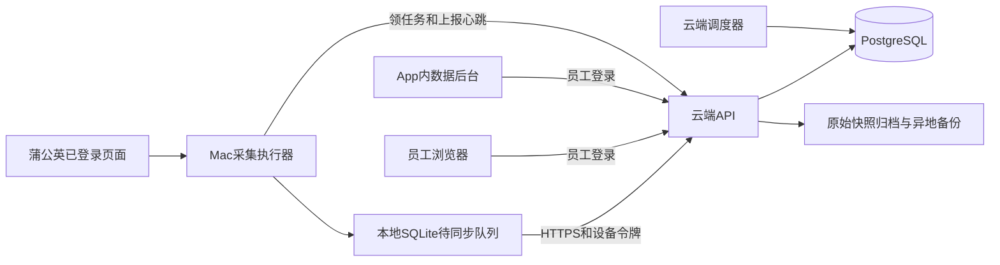

# 云端数据库迁移建议

日期：2026-09-13。状态：方案待实施，本次不部署。

> 用户后续调整：暂不考虑迁移上云。当前执行优先级改为[本地服务优化计划](../../dev-work/local-service-optimization/implementation-plan.md)。本文件仅保留未来参考，不代表当前开发任务。

## 1. 推荐结论

保留Mac内置浏览器作为采集执行端，云端独立部署Node API、React后台和PostgreSQL。员工从浏览器或App内后台访问同一份公司数据。SQLite继续承担本地采集缓存和待同步队列。

可以使用youbet所在服务器，但作为独立服务、独立数据库角色、独立数据目录和独立子域名，配额和备份隔离。沿用之前约定，不改youbet业务代码和业务库。6月的连通性记录不是9月的容量验证，本次未SSH或部署，实施前重新检查CPU、内存、磁盘、网络延迟和端口。

结合已有明确的多人访问需求，第一版云端直接用PostgreSQL；不再额外做“服务器SQLite过渡版”。已有SQLite方案保留在客户本地Demo。

## 2. 真实现状

| 模块 | 当前实现 | 迁移影响 |
| --- | --- | --- |
| desktop/src/main.js | Electron、内置页面、本地3188服务、文件导出 | 增加云端连接、设备认证、后台重启与日志 |
| desktop/src/renderer.js | 列表/昵称/相似、详情、补采、入库队列、定时刷新集中在一个文件 | 提取采集流程、字段解析、任务执行、同步四个清晰模块 |
| data-console/src/server.js | Express HTTP接口与静态页面 | 增加员工会话、权限、设备接口、严格入参、版本化契约 |
| data-console/src/db.js | 同步SQLite实现、主表、快照、备注、任务、MCN历史 | 保留业务规则，数据访问异步化并添加PostgreSQL实现与迁移 |
| field-labels / collector-fields / exporter | 中文字段、列类型和导出逻辑分布维护 | 一个字段注册表统一口径、单位、类型、展示、导出、可空语义 |
| App.jsx | 本地员工切换、顶部筛选、详情、任务面板 | 真登录、完整任务清单、分页详情、查询/修改错误反馈 |

当前真实流程：读完指定范围的列表，逐条写本地库；再逐个详情增强，再空值补采。每日更新单独按博主串行执行。旧文档“每页增强后翻页”不符合当前启动参数。

本机只读检查：114位博主、482份快照、22个批次、2次每日任务；quick_check=ok；2位历史博主无ID。3188当前没有运行服务，因此本次不声称已经验证真实网页采集或新的桌面运行效果。

## 3. 目标架构

- 蒲公英登录态保留在执行Mac；上传的是业务采集结果，不上传浏览器Cookie。
- 云端负责查询、备注、权限、安排任务、保存清单和同步进度；云端本身不会因为迁库而获得已登录的蒲公英浏览器。
- 第一阶段使用PostgreSQL任务表，暂不引入Redis、Kafka、Elasticsearch或微服务。
- App内可使用同一套Web后台，但远程页面只能调用明确授权的采集动作；校验页面来源，不能继承任意本地文件/IPC权限。

## 4. 数据模型

| 数据层 | 表/对象 | 关键规则 |
| --- | --- | --- |
| 公司与员工 | workspaces、users、memberships、sessions | 公司内共享；不同客户workspace隔离；员工权限由会话决定 |
| 设备 | collector_devices、device_tokens | 记录所属公司、版本、在线状态、最近心跳；令牌可撤销 |
| 博主身份 | bloggers、blogger_aliases | UNIQUE(workspace_id, platform, platform_blogger_id)；平台ID用TEXT，不用小红书号/昵称替代 |
| 最新数据 | blogger_current或分模块最新指针 | 按来源数据时间与有效状态选取；各模块有独立更新时间和质量标记 |
| 历史 | blogger_snapshots | 不可变记录；保存采集模式、schema_version、parser_version、event_id、source_updated_at、observed_at、received_at |
| 指标口径 | 快照内固定数值列+metrics JSONB | 近30/90、日常/合作、图文/视频、全流量维度明确，禁止混合填充 |
| 原始证据 | raw_payloads或压缩对象 | 原始响应只保存一次；带请求参数与校验和，不进入列表和普通导出 |
| 商业笔记 | cooperation_notes与快照关联 | 按note_id保存品牌、发布时间、标题；列表数量与全部历史数量区分 |
| 标签/协作 | blogger_tags、blogger_notes、audit_logs | 人工标签与采集标签分开；修改记录操作者、前后值、版本 |
| 机构变化 | blogger_mcn_history | 仅比较已确认结果；未知不等于无机构；首次发现与变更分开 |
| 任务 | collect_batches、job_runs、job_items、job_attempts | 待处理/处理中/成功/缺失/失败/暂停/取消；每位博主始终有可追踪明细 |
| 同步 | ingestion_events / 幂等索引 | 相同event_id只提交一次；批次计数按唯一博主项计算 |
| 删除 | deleted_at、deleted_by、删除事件 | 可恢复，防止迟到上传把已删除博主复活 |

稳定常用指标用整数/decimal数值列以支持筛选；扩展数据放JSONB，原始文本保持原样归档。JSONB可建立索引，但不是把所有内容塞成一个大文档的理由。[PostgreSQL JSON类型](https://www.postgresql.org/docs/current/datatype-json.html)

金额统一人民币元并使用decimal；计数用整数；比例统一0到1，界面负责显示百分号。现有parseNumber会把37.5%存成37.5，迁移必须按字段字典转换，不能再靠数值大小猜百分比。

时间以UTC timestamptz保存，界面显示Asia/Shanghai；既有无时区时间按写入来源判定（采集页面通常是北京时间，SQLite默认创建时间是UTC），无法确定的历史标记待核验。

空值用状态区分：有效值、明确0、平台无数据、页面失败、未采此字段、权限不足。不完整快照仍保存；主列表可显示上次有效值，但必须显示那次的数据日期，不能标为刚更新。

## 5. 云端写入与断网恢复

1. 每次实际采集尝试分配run_id、item_id、attempt_id、event_id。
2. 记录先落本地outbox；界面可以立即显示“已采集，待同步”。
3. 设备通过HTTPS向API分块上传；新采集保留不同event_id，网络重放复用原event_id。
4. 服务端校验设备所属workspace、博主ID、字段类型、时间和数据口径。
5. 一个事务完成快照、最新状态、MCN变更和任务明细更新；唯一约束处理重复重放。
6. 服务端提交后返回回执；客户端才标记已同步。
7. 网络故障自动退避重试；永久校验失败进入待处理清单；退出/重启后继续补传。

同步时以云端为公司协作主库，本地仅缓存。服务端不能信任客户端任意传workspace/userId，不能把数据库密码打包到App。

批次结束显示采集数、云端已确认数、待同步数、失败数。确认上传成功之前不使用“全部已入库”。删除后的迟到事件、过期租约结果和历史导入分别走明确规则。

## 6. 员工协作与权限

- 管理员管理员工、任务配置和回收站；编辑员工查数据、备注、更新；只读员工按分配权限查数据/导出。
- Web用服务器会话，Cookie设置HttpOnly、Secure、SameSite，并做请求来源/CSRF防护；Mac设备使用可撤销令牌，保存到系统安全存储。
- 行级隔离同时落实在API与PostgreSQL策略。数据库运行角色不能是超级用户或BYPASSRLS角色；表所有者默认绕过RLS，需要明确选择非owner运行角色或强制RLS。[PostgreSQL行级权限](https://www.postgresql.org/docs/current/ddl-rowsecurity.html)
- 同时修改备注用revision进行乐观锁，冲突时展示服务器最新值。操作记录由后端取真实操作者，记录必要前后值。
- 第一版只创建公司一个workspace；以后给客户建独立workspace，默认不共享公司博主库、备注和原始响应。授权码管理是否恢复独立决策，不作为员工登录替代。

## 7. 每日增强更新

- 云端按北京时间生成持久任务和完整博主清单；优先级可分重点博主、待合作、最久未成功更新、失败待重试。
- 调度按最近成功增强时间选择，不能按任意一次失败写入时间轮转。黑名单/回收站/停用项按配置排除。
- Mac领取一个任务项再打开详情页，串行采集。短事务用行锁领取、提交租约后结束事务，不在网页等待期间一直锁数据库。PostgreSQL的SKIP LOCKED适用于此类多消费者任务表。[PostgreSQL SELECT](https://www.postgresql.org/docs/current/sql-select.html)
- 心跳续约、租约超时回收，执行代号防止旧进程迟到结果覆盖新任务；同workspace+设备限定一个活动采集流程。
- 暂停保留未完成清单；继续只处理剩余项；失败/缺失分页列出，可导出或只重试选中失败者。
- Mac离线、睡眠或蒲公英登录失效时显示“等待设备/需要登录”，暂停领取。服务器在线不代表Mac执行器在线。
- 每日进度显示总数、已处理、成功、缺失、失败、待同步、当前博主、最近有效进展与预计剩余时间。

容量与时间要分开：

- 每天1,000-2,000位，3-4万库完整轮转约15-40天；不是全库每天最新。
- 真实历史任务#1：112位，47分26秒，105成功/7缺失；每位约25.4秒。线性估算1,000位约7.1小时，2,000位约14.1小时，不能作为承诺。
- 历史任务#2：112位，约10小时8分，80成功/32缺失；墙钟时间可能包含休眠/重试/其他等待，缺少阶段日志，不能把它全部归因网络慢。
- 先进行200位代表样本实跑和24小时恢复测试，测每阶段耗时与成功率。多设备扩容仅在允许的账号使用条件和实际容量验证后做；不依靠激进并发来承诺产能。

## 8. 查询与存储预算

- 列表只返回展示和筛选需要的轻字段；详情原文按需读取；历史快照、笔记、任务项各自游标分页。
- 按workspace+更新时间/稳定ID建立主索引，常用粉丝、报价、商业字段建立受控复合索引；针对实际筛选EXPLAIN ANALYZE，不为所有列盲目加索引。
- 昵称、小红书号精确匹配走索引；中文子串搜索用pg_trgm配合LIKE/ILIKE，并专项测试1-2字短词及中文排序。可用trigram过少时仍可能退化扫描，需基于4万规模验证。[pg_trgm官方说明](https://www.postgresql.org/docs/current/pgtrgm.html)
- 导出使用独立后台任务和分页读取，冻结导出结果范围，输出行数与筛选总数核对，避免并发更新造成漏行。

本机112份带原始响应的快照，原始API平均47,845 bytes，标准化raw_json平均56,285 bytes（目前包含重复原文）。当前50位列表约6.04MB、112位候选约13.76MB，应先精简。

按每天1,000-2,000份最终快照，一年约36.5-73万份。仅原始API未压缩体量约17.5-34.9GB/年；按当前双份JSON存法约38-76GB/年，未含索引、结构化列、WAL和备份。失败重试另计。旧文档基于无raw_api快照的估算不能直接套用。

第一版建议预留本服务4vCPU/8GB内存的资源预算与约100GB可扩展数据库磁盘；原始响应压缩后放独立对象存储并保留检索索引，备份放异地。该配置是起步预算，不是对youbet服务器现有余量或压测结果的声明。结构化历史长期保留，原文归档不默认删除，保存年限另设运营规则。

## 9. 迁移步骤与回退

1. 先修身份匹配、口径、空值、最新数据选择、写入确认、完整清单和后台恢复问题，冻结字段契约。
2. 从现有SQLite制作一致性备份，纳入WAL里已提交数据。使用SQLite Backup API；不能只复制正在使用的pgy.db。[SQLite在线备份](https://www.sqlite.org/backup.html)
3. 迁移到独立预演库：博主、全部快照、批次明细、备注、标签、MCN、操作记录、任务记录。保留源库指纹与旧ID到新UUID映射，导入可重复执行而不重复新增。
4. 先整理ID缺失/冲突、非法JSON、异常比例、时间混用；2位无ID历史放待核对区。不得仅导入最新CSV，因为那会丢历史、备注和批次。
5. 核对表计数、每位快照数、备注数量、主外键、原始响应校验和、关键口径样本及时间排序；错误旧值不猜测修正，标记后增强重刷。
6. 云端预演通过后做短暂写入冻结/增量对齐，备份本地原库，App切换云端。上线后本地outbox保留已确认事件一个受控回退窗口。
7. 先用少量博主完成采集、断网补传、员工备注、导出、删除恢复验证，再逐步放大到每日任务。
8. 回退时保留云端新增事件与协作记录，将它们导出/重放后再切回，不能简单用旧本地库覆盖新云端数据。原SQLite保持可恢复副本。

## 10. 备份、监控与验收

- 本服务独立运行用户、服务进程、数据库账号和备份；数据库端口仅内网可达，对外只开HTTPS后台入口。
- 建议初始目标：数据恢复点不超过15分钟，服务恢复不超过2小时；这必须由备份配置和恢复演练证明，当前未实现。
- 每日逻辑备份用于便捷恢复；需要上述恢复点目标时启用基础物理备份+持续WAL归档/PITR。pg_dump不能代替PITR的基础备份。[PostgreSQL备份恢复](https://www.postgresql.org/docs/current/continuous-archiving.html)
- 监控API错误/延迟、任务无有效进展、设备心跳、上传积压、缺失率、磁盘/WAL增长、备份成功和恢复校验。
- 验收规模：4万博主+至少一年量级历史的合成库，按预计员工并发查询/备注，与实际采集并行。
- 验收正确性：未登录不可读写；跨workspace不可访问；同事件重放10次只提交一次；旧快照不覆盖新数据；失败不制造MCN退出；未知不是0；导出不截断。
- 验收任务：暂停继续、设备关机重启、断网重传、上传提交后丢回执、重复启动、令牌失效、用户改名、错误ID、慢30/90日切换。

## 11. 实施顺序和交付物

| 阶段 | 交付结果 | 完成标准 |
| --- | --- | --- |
| A 本地可靠性修复 | 可验收的本地App和问题回归集 | 本次P1复现转成期望行为测试通过 |
| B 云端代码预演 | PostgreSQL迁移、账号权限、隔离API、精简列表 | 独立预演环境可用，迁移核对完成 |
| C App联动 | 云端后台Tab、设备令牌、持久outbox、任务执行 | 断网/重启/丢回执无丢数和重复计数 |
| D 日更与协作 | 云端调度、全量清单、失败重试、回收站 | 代表样本实跑和4万库查询验证完成 |
| E 上线 | 独立部署、备份监控、切换与回退方案 | 容量检查、权限回归、恢复演练通过后切换 |

本次只完成复核与方案，未改变业务实现、未清理本地用户数据、未生成新App、未修改youbet。
