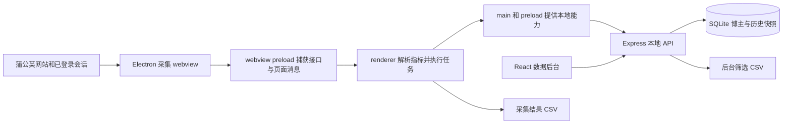

# 蒲公英博主采集助手项目交接与代码完整性核查

核查日期：2026-11-09；同日更新源码归档交接信息。面向项目负责人及下一位接手开发者。下列命令从克隆后的仓库根目录执行。

## 同日源码归档更新

本文保留 2026-11-09 初次核查的测试、缺陷和发布物证据；同日另行整理各组件最新源码与交接文档，准备纳入 GitHub `main`。本次归档包括建立 Git 源码基线、配置秘密与本地产物排除规则，以及将授权生成器的飞书凭据改为环境变量或被忽略的本地配置；私钥、真实用户库、依赖目录和历史发布物不随源码归档。归档目标为 [Liumang/pgy_Collector](https://github.com/Liumang/pgy_Collector)；最终提交及推送结果以该仓库 main 的 Git 记录为准。

这次源码归档不表示下述业务缺陷已经修复，也不构成重新打包、真实采集或上线验收。旧 App/zip 的一致性和签名结论只对应初次核查时的产物；后续源码变更不自动进入这些产物。

**核心业务源码基本齐备，可以继续开发；当前交付状态是本地 Demo，尚未达到稳定正式版本的完成标准。** 桌面采集、数据库后台、授权后台和打包工具都有实现，但数据准确性、可靠入库、任务恢复和发布工程仍有明确缺口。现有 16 项单元测试通过，同时 21 项缺陷观察全部仍能复现，不能据测试绿灯认定项目已完成。

初次核查完成聊天上下文核对、当时源码审查、隔离测试、前端构建和现有发布物核查；该核查阶段未修改业务代码、未读取或改写真实用户数据库、未重新打包、未启动真实蒲公英采集或部署服务器。同日源码归档调整单列于上方，不改变初次核查结论。

归档新增的生成器配置行为测试7/7通过，未请求飞书或签发授权；初次核查的16项核心测试和21项缺陷观察范围保持不变。生成器配置方式见 [配置说明](../../license-generator/README.md)。

## 项目范围和当前决定

项目主线是 Mac 上的蒲公英博主采集工具：用户在内置浏览器登录、设置筛选，采集列表或详情，数据进入本地博主库，再用于筛选、备注、更新与导出。

[采集助手原聊天](thread://019e2e8a-233b-7623-829f-303a35d5f1ab?hostId=local)最后一项开发决定是：**先不迁移上云，先优化本地服务。** 现有开发计划分四批、26 项任务，当前任务清单全部未勾选，执行入口也明确“业务实现尚未启动”。本次复查的主要缺陷仍在，因此不能将该计划当作修复完成记录。

云端数据库、员工登录与权限隔离、服务器部署、线上授权整合属于后续方向。保留已有方案，接手时先沿用本地范围。

## 完整性结论

| 核查维度 | 当前结论 | 对接手者的含义 |
| --- | --- | --- |
| 核心源码 | 主线模块及运行入口齐备 | 已有可维护的产品基础，无需从零重写 |
| 基本功能 | 采集、入库、查询、备注、更新和导出已有实现 | 功能存在不等于所有边界正确 |
| 数据准确性 | 未完成 | 仍会采错人、串身份、混用指标、将未知值写成零 |
| 稳定运行 | 未完成 | 写库失败缺持久恢复，后台退出与暂停续跑不可靠 |
| 正式授权 | 当前 Demo 未接入完整客户校验 | 后台授权能力与历史生成器不能直接视为已闭环 |
| 发布物 | 有与当前源码对应的 App 和 zip | 只验证了部分源码一致性和签名，未完成真实运行验收 |
| 工程复现 | 仍有缺口 | 本次归档建立 Git 基线并排除本地秘密；干净机器安装及重新打包仍未验证 |
| 大规模使用 | 待验证 | 4 万博主、全年历史、200 位采集和 24 小时长跑仍是计划 |

## 目录和版本

| 路径 | 职责 | 当前版本或状态 |
| --- | --- | --- |
| `desktop/` | Electron 桌面壳、内置浏览器、采集、入库桥接、任务调度 | `0.2.3-demo`，已装 Electron `31.7.7` |
| `data-console/` | Express API、SQLite、React 数据后台、授权管理界面 | `0.2.0` |
| `license-generator/` | 运营方 Mac 授权码生成器，签发后写入飞书 | `1.2.1`，运行需单独配置凭据与私钥 |
| `license-tools/` | 历史命令行授权签发 | 不写入飞书，与生成器流程不同 |
| `pgy-kol-collector/` | 早期 Chrome Manifest V3 插件 | `0.4.0`，历史实现参考 |
| `tools/`、`mac/` | 早期插件检查、打包与 Mac 辅助脚本 | 不是当前桌面主线构建入口 |
| `dist/` | 桌面 App、生成器和多个历史发布包 | 不能仅凭文件名判断使用哪个版本 |
| `dev-work/local-service-optimization/` | 当前本地优化实施计划和验收条件 | 26 项任务待实施 |
| `acceptance-work/2026-09-13-cloud-readiness/` | 旧审查、问题清单与隔离复现脚本 | 仍可用于问题复现 |
| `docs/plans/` | 交接、迭代、操作记录与历史设计 | 本文作为当前交接入口 |
| `showtime-intro-video/` | 独立视频工程 | 不属于采集助手交付主线 |

**根目录 `npm run check` 只检查早期 Chrome 插件。** 它不会代替 `desktop`、`data-console` 的检查与测试。

## 架构和核心调用链



桌面入口是 [main.js](../../desktop/src/main.js#L15)，界面与流程主要集中在 [renderer.js](../../desktop/src/renderer.js#L2892)。后者约 3,564 行，混合了页面脚本、指标解析、任务控制、数据库队列和定时逻辑，是当前维护风险最大的文件。

主要链路如下：

- **采集和增强**：页面脚本获取列表 → `records` 消息 → ID 检查与内存去重 → 追加数据库批次。当前增强实际执行顺序为“先扫描全部列表页 → 全量逐个详情增强 → 空值检查补采”。旧文档中的“每页详情结束后再翻页”与当前实现不一致，见 [完成消息处理](../../desktop/src/renderer.js#L2933)。
- **三种任务入口**：当前列表、昵称文件上传、相似博主。相似模式会强制使用普通采集，不能将它描述为普通和增强均可选，见 [模式约束](../../desktop/src/renderer.js#L3418)。昵称文件支持 XLSX、CSV、TXT 第一列；XLSX 依赖系统 zip/unzip，CSV 的含逗号引号字段解析仍有限制。
- **边采边入库**：`appendRecordsToDatabase` → Electron IPC → 本地批次追加 API → SQLite 事务。当前写入队列只在内存中，不是可恢复的持久待写队列。
- **每日更新和手动重刷**：数据后台发起 → Electron 按候选串行访问详情 → 写入批次和运行统计。计划和运行摘要有存库，逐项待执行清单没有持久化；定时触发依赖桌面 renderer 存活。
- **数据后台**：React 使用同源 `/api`，Express 调用 `DataStore`。开发时 Express 挂载 Vite，生产模式读取 `data-console/dist`，见 [前端挂载](../../data-console/src/server.js#L423)。

### 已有用户能力

桌面端具备内置蒲公英浏览器、持久登录会话、开始与停止、CSV 导出、基础和增强字段采集、缺 ID 跳过、详情质量检查及一次空值补采。后台具备筛选、排序、详情、员工备注、合作状态、批次、机构变化记录、每日更新计划与运行摘要。详情按字段组展示，已配置业务字段的空值显示为 `-`。

“全部字段展示”指已配置的字段；接口缓存只保留各类最后一次响应，部分笔记与相似列表还有条数限制，不能理解为蒲公英全部接口、所有分页和全部历史数据均已采全。

## 数据和运行配置

数据库使用 `better-sqlite3`，启用 WAL 和外键，启动时自动建表并补字段，见 [建库入口](../../data-console/src/db.js#L102)。当前缺少独立、明确编号的数据库迁移版本体系。

| 表 | 用途 |
| --- | --- |
| `bloggers`、`blogger_snapshots` | 博主身份、最新快照指针、历史指标和原始响应 |
| `collect_batches`、`batch_items` | 采集批次与明细 |
| `blogger_tags`、`blogger_notes`、`blogger_mcn_history` | 标签、备注和机构变化 |
| `users`、`audit_logs` | 员工资料和操作记录；员工资料没有密码会话体系 |
| `update_jobs`、`update_job_runs` | 每日计划和运行统计；不是可恢复任务队列 |
| `licenses`、`license_events` | 后台授权及激活等事件 |
| `blogger_search` | FTS5 搜索索引，使用 unicode61 |

默认 Mac 数据目录为 `~/Library/Application Support/PGY Collector/data/`，库文件是 `pgy.db`，与源码目录及 App 包分开。规则见 [path.js](../../data-console/src/path.js#L4)。本次没有重新统计真实库数量；历史文档中的博主、快照数量不代表当前数量。

| 配置 | 行为 |
| --- | --- |
| `PGY_DATA_CONSOLE_DIR` | 覆盖后台数据目录；测试必须用独立目录 |
| `PGY_DATA_CONSOLE_HOST` | 独立后台监听地址，默认 `127.0.0.1` |
| `PGY_DATA_CONSOLE_PORT` | 独立后台端口，默认 `3188`；桌面壳当前按自己的固定地址连接 |
| `NODE_ENV=production` 或 `PGY_DATA_CONSOLE_STATIC=1` | 使用已有前端构建产物 |
| `PGY_LICENSE_ADMIN_ENABLED=1` | 打开授权管理入口与管理 API；这是功能开关，不是身份认证 |

启动后台会初始化表、默认员工和每日计划，不是只读操作。修改数据结构或正式用户数据前，先做 SQLite 一致性备份，并在独立目录验证恢复；WAL 活跃时不能把单独复制 `pgy.db` 当作可靠备份。

## 当前缺陷和修复优先级

P1 指会影响数据身份、准确性或核心恢复能力的问题；P2 指重要体验、规模与维护问题。下表中的“复现”使用假数据、内存库或函数 mock，不代表做过真实网站回归。

| 优先级 | 问题和影响 | 当前定位 | 本次证据 |
| --- | --- | --- | --- |
| P1 | 搜索不匹配时选第一行，可能采错昵称或相似种子 | [renderer.js](../../desktop/src/renderer.js#L2631) | Wanted 只有 Unrelated 时仍返回后者，已复现 |
| P1 | 不同稳定 ID 仍因同昵称与小红书号合并，历史串人 | [db.js](../../data-console/src/db.js#L718) | ID A、B 合成一个博主，已复现 |
| P1 | 日常指标用合作指标补位，30/90 日响应共槽，近30日数量可退回累计值 | [指标补位](../../desktop/src/renderer.js#L440)、[响应分类](../../desktop/src/renderer.js#L837)、[数量解析](../../desktop/src/renderer.js#L933) | 0 被合作阅读321替换、累计999被填入近30日，均已复现 |
| P1 | 未知数值变0，缺合作数时商单占比显示0% | [importer.js](../../data-console/src/importer.js#L134)、[比例呈现](../../data-console/src/db.js#L1193) | 暂无、N/A、null 均转0，已复现 |
| P1 | 未读到机构默认无机构，产生虚假退出记录 | [renderer.js](../../desktop/src/renderer.js#L925) | 缺失解析结果覆盖已知机构，已复现 |
| P1 | 旧或不完整快照无条件成为最新，增强字段被清空 | [db.js](../../data-console/src/db.js#L624) | 旧记录覆盖新记录、普通更新清掉增强展示，均已复现 |
| P1 | 写库失败被吞，收尾仍提示已入库；重放重复快照和计数 | [写入队列](../../desktop/src/renderer.js#L316)、[批次追加](../../data-console/src/db.js#L603) | 失败后仍提示保存、同事件写两次计数2，均已复现 |
| P1 | 后台自然退出后无法重启，错误日志也被丢弃 | [main.js](../../desktop/src/main.js#L106) | 已退出进程 killed=false 时 spawn 次数0，已复现 |
| P1 | 无持久逐项清单，运行锁设置偏晚，停止缺少执行代号隔离 | [日更入口](../../desktop/src/renderer.js#L3110)、[定时器](../../desktop/src/renderer.js#L3358) | 源码确认；重复启动、迟到响应和休眠长跑未实测 |
| P1 上云阻断 | 员工切换不是真登录，接口信任传入 userId | [server.js](../../data-console/src/server.js#L62) | 无登录凭证删除内存库博主成功；默认仍为回环监听 |
| P2 | 筛选导出最多200条且没有完整性提示 | [导出 API](../../data-console/src/server.js#L88)、[分页上限](../../data-console/src/db.js#L896) | 205位只导出200位，已复现 |
| P2 | 原始数据重复保存，随列表及候选返回，还进入业务 CSV | [列表查询](../../data-console/src/db.js#L806)、[CSV字段扩展](../../data-console/src/exporter.js#L26) | 重复保存及进入CSV已复现；本次未重新压测容量 |
| P2 | 中文中间词搜不到，更新采集标签只增不删 | [搜索](../../data-console/src/db.js#L828)、[标签](../../data-console/src/db.js#L794) | 一口锅搜不到开局一口锅锅、旧标签仍命中，均已复现 |
| P2 | 失败仅显示8位、任务明细24位、历史8次，缺完整分页浏览 | [App.jsx](../../data-console/src/ui/App.jsx#L828) | 源码确认 |
| P2 | 详情旧请求可能覆盖新选择，保存失败可能清空输入 | [详情请求](../../data-console/src/ui/App.jsx#L265)、[备注保存](../../data-console/src/ui/App.jsx#L394) | 源码风险，未做网络节流UI复现 |
| P2 | 失败HTTP响应仍入缓存，加载判断可能把错误对象当完成 | [响应入缓存](../../desktop/src/renderer.js#L857) | 403响应进入指标槽位，已复现 |

另有删除直接级联清除关联、时间格式混用、无进展保护以状态文字刷新计时等问题。完整历史分类和触发解释见 [19组问题清单](../../acceptance-work/2026-09-13-cloud-readiness/issue-log.md)。本次核查没有把它们标为修复完成。

## 授权和交付边界

### 当前授权状态

当前 `0.2.3-demo` 的 [初始化](../../desktop/src/renderer.js#L2892)直接进入采集界面，当前 main/preload 未提供旧文档所述完整授权校验接口。后台虽然已有随机授权码、哈希存储、机器绑定、停用、换机重置与事件记录，但这只能证明服务端逻辑存在。

历史签名授权码、飞书生成器、后台随机码和当前桌面 Demo 是不同阶段的实现。旧使用说明里的“启动必须授权”“配置后即可线上验证”，均须按当前源码重新核对，不能据此承诺正式客户授权已打通。

### 敏感工具和材料

初次核查时，`license-generator/src/main.js` 含硬编码飞书应用凭据；同日源码归档已将该配置方式改为环境变量或被忽略的本地配置，具体配置项以生成器源码及配置说明为准。授权私钥仍属于运营方本地材料，不进入 Git 归档；`license-generator/private-key.pem`、`license-tools/private-key.pem` 及根目录扩展签名 PEM 的本地副本由项目负责人单独保管。生成器打包流程涉及运营私钥，因此生成器 App 也只供运营方使用。这里未复制任何秘密值，也未验证凭据有效性。

移交时将客户 App、可开发源码、运营授权工具分别整理。生成器及其 zip 只供授权运营方使用；源码归档通过排除规则隔离密钥、凭据、用户库与导出数据；后续打包仍需核对实际交付内容。

### 现有客户发布物

以下为原核查机器上的本地历史产物，不随 Git 源码归档：

- `dist/PGY Collector Desktop.app`。
- `dist/pgy-collector-desktop-mac-v0.2.3-demo.zip`。

初次核查时，App 与该 zip 中的 `desktop/src` 9 个文件、`data-console/src` 10 个文件，均与当时源码逐字节一致。`codesign --verify --deep --strict` 通过，但签名为 ad-hoc、无 TeamIdentifier；可执行文件为 arm64。当前没有 Intel、universal 或 Developer ID 公证交付的验收结果。

最新版 zip 按路径检查未发现 PEM、env、DB、SQLite、CSV 文件；这项检查不等于对包内全部内容完成秘密扫描。

该 zip 的 SHA256：

```text
1f23e03981c1d8dc541cd9046eec6e7bc8ff7286f4ebe4201680c80997304860
```

## 本次验证和复现命令

本机验证环境为 Node `20.19.5`、npm `11.14.1`，使用已有依赖。下列检查均于 2026-11-09 执行。

| 检查 | 结果与边界 |
| --- | --- |
| `npm --prefix desktop run check` | 6个桌面JS入口语法检查通过 |
| `npm --prefix desktop test` | 2/2通过，仅覆盖记录ID去重、跳过缺ID及摘要 |
| `npm --prefix data-console run check` | 数据后台JS语法检查通过 |
| `npm --prefix data-console test` | 14/14通过，使用随机临时数据库 |
| `npm run check` | 早期插件版本一致性及语法检查通过 |
| `node --check license-generator/src/main.js` 等三个JS入口 | 语法检查通过；未签发真实授权或请求飞书 |
| `data-console npm run build -- --outDir <独立临时目录>` | Vite构建通过，未覆盖项目现有dist或客户App |
| `node acceptance-work/2026-09-13-cloud-readiness/reproduce.cjs` | 21项缺陷观察全部命中，使用内存库、假数据和本地临时HTTP服务 |
| 现有App与zip源码对照、签名核查 | 上述19文件一致，现有App签名完整性检查通过 |

**复现脚本退出码0表示错误行为仍存在，不是通过21项产品验收。** 后续修复应把对应观察改成正确行为的回归断言，不得为了维持脚本绿灯保留缺陷。

在项目根目录复查基线：

```bash
cd .
npm --prefix desktop run check
npm --prefix desktop test
npm --prefix data-console run check
npm --prefix data-console test
npm run check
node acceptance-work/2026-09-13-cloud-readiness/reproduce.cjs
```

独立检查后台时使用单独端口和数据目录，避免连到正式库：

```bash
audit_data_dir=$(mktemp -d /tmp/rednote-handoff-data.XXXXXX)
PGY_DATA_CONSOLE_DIR="$audit_data_dir" PGY_DATA_CONSOLE_HOST=127.0.0.1 PGY_DATA_CONSOLE_PORT=3198 npm --prefix ./data-console run dev
```

`3198` 是示例测试端口，使用前确认空闲；结束后停止该测试服务。此方式只启动独立后台，不会自动改变桌面壳连接地址。

源码桌面启动命令是 `npm --prefix ./desktop start`。它可能启动默认3188后台并使用正式数据目录，运行前确认现有App与采集任务状态。本次未执行该GUI启动，也未验证真实网页字段、登录、慢加载、休眠、断网恢复和长跑表现。

## 构建和维护缺口

1. **版本控制交接**：初次核查时没有 Git 基线和项目 `.gitignore`；同日源码归档建立基线并配置排除规则。接手者先核对实际分支、提交和工作区，确认用户数据、秘密与历史产物未被跟踪，再做行为修复。
2. **依赖安装复现未完成**：`desktop` 和 `data-console` 有 lockfile，现有 node_modules 能完成本次检查；没有验证干净机器 `npm ci`。`desktop/package.json` 为 `0.2.3-demo`，其 lockfile 根版本仍为 `0.2.2-demo`，应同步元数据，但不能据此认定安装已经失败。
3. **构建依赖宿主环境**：[桌面打包脚本](../../desktop/tools/package-mac.mjs#L9)要求已有 Electron.app；后续要在包副本中重编译 better-sqlite3，可能需要 Electron headers 下载和编译工具。生成器也借用 desktop 的 Electron，不能独立安装构建。
4. **原生模块目标可能漂移**：打包时从依赖声明 `^31.7.7` 推导重编译目标，而非读取实际复制的 Electron 版本。当前已装版本恰为31.7.7；后续依赖变化需核对实际运行时与SQLite ABI。
5. **打包未包含测试关口**：脚本只执行语法检查与前端构建；单元测试需另行运行。脚本会覆盖同名App及同版本zip，本次未为检查而重打包。
6. **打包文件范围过宽**：data-console采用目录复制，排除项很少，应改为明确交付白名单。当前包未发现上述敏感文件类型，并不能保证后续新增配置不会被带入。
7. **运行时验证不足**：IPC发送来源、导航、弹窗和页面消息桥接需要在正式交付前统一约束；依赖升级应单独验证网站兼容和原生模块，不能把源码Node测试当作Electron产物测试。

准备新桌面包时，先完成相关测试，留存需要保留的旧发布物，再执行以下命令。打包脚本会覆盖固定App路径和同版本zip，不能把它当作无副作用的检查命令。

```bash
npm --prefix ./desktop run package:mac
codesign --verify --deep --strict "./dist/PGY Collector Desktop.app"
```

这些工程问题优先做有边界的修复；没有必要为此次接手同时替换框架或迁移数据库。

## 下一位开发者的执行顺序

先读 [当前开发入口](../../dev-work/local-service-optimization/build-handoff.md)，再按现有 [任务明细](../../dev-work/local-service-optimization/task-breakdown.md)和 [验收条件](../../dev-work/local-service-optimization/verification-plan.md)推进。

| 阶段 | 对应任务 | 可交付结果 |
| --- | --- | --- |
| 建立基线 | T00 | 一致性备份及隔离恢复、源码检查点、当前问题复现 |
| 第一批 数据准确性 | T01至T07 | 精确身份、正确指标窗口、未知与0分离、有效最新值、MCN三态、真实入库结果 |
| 第二批 稳定性 | T08至T15 | 后台恢复日志、持久待写与事件防重、统一任务边界、暂停重启续跑、可靠本机调度 |
| 第三批 后台维护 | T16至T22 | 轻量查询、完整导出、中文搜索、完整清单、保存反馈、回收站、备份诊断 |
| 第四批 验收交付 | T23至T25 | 4万规模验证、真实采集与长跑、当前打包产物运行验收 |

第一批的验收必须覆盖列表、昵称、相似、普通、增强、CSV、单人重刷和每日更新的受影响入口。同一博主的不同合法采集要保留历史，同一次写入重试则必须防重，不能用“每天只保留一条”替代幂等。

每批完成后更新迭代和操作记录，记录已通过与未通过的验收，再生成新版本。版本交付需检查实际App中的版本、数据库路径、两页签、原生库加载和真实采集结果；本次已有测试记录不能代替这些运行结果。

云迁移若重新启动，以 [历史迁移方案](2026-09-13-cloud-database-migration-plan.md)作为讨论起点，并重新核对当前数据、服务器和授权要求。数据库搬到服务器不会自动解决网页采集速度、数据口径或任务恢复。

## 接手资料索引

- [本地优化实施计划](../../dev-work/local-service-optimization/implementation-plan.md)。
- [技术上下文](../../dev-work/local-service-optimization/technical-context.md)与 [风险登记](../../dev-work/local-service-optimization/risk-register.md)。
- [功能迭代记录](2026-05-25-feature-iteration-tracker.md)、[开发操作记录](2026-05-25-development-operation-log.md)、[发布检查清单](2026-05-25-release-and-delivery-checklist.md)。
- [使用说明](../../蒲公英博主采集助手_使用说明.md)与 [增强字段字典](../../ENHANCED_MODE_FIELDS.md)：字段来源可参考，授权和增强执行顺序须服从本次当前源码核对结果。
- [2026年5月旧交接](2026-05-25-project-status-handoff.md)：仅作演进背景，其中“未建数据库”等状态已过期。

可直接发给接手开发者的指令：

```text
继续 rednote 蒲公英博主采集助手项目。
先读 docs/plans/2026-11-09-project-handoff.md，
再读 dev-work/local-service-optimization/build-handoff.md 与任务、验收文件。
当前目标是本地优化，云迁移暂缓；不要把计划Ready或旧缺陷复现绿灯当作实现完成。
核对当前工作区和任务状态，核对本次归档的实际提交与排除规则，补齐T00的备份及恢复验证，再按T01-T07做第一批修复。
真实用户库不用于破坏测试，运营秘密不得进入公开源码或客户交付包。
```
